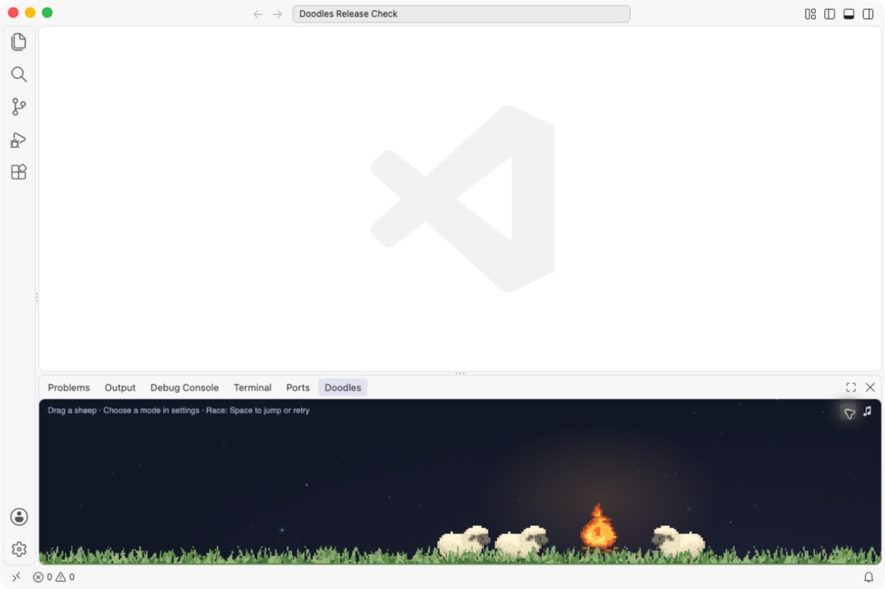

# Doodles for VS Code

A little world alongside your work: grazing sheep, weather, changing skies, and playful modes. This is an experimental personal project. Bugs are expected; small fixes and pull requests are welcome.



## Try the extension

Download [doodles-0.3.1.vsix](https://github.com/shubhaja/doodles-for-vscode/releases/download/v0.3.1/doodles-0.3.1.vsix) and install it using **Extensions → … → Install from VSIX**, then run **Doodles: Open Pasture** from the Command Palette. Move the view to a panel or sidebar and open its gear menu.

The portable extension includes sheep, flowers, fireflies, Disco, Race, Cozy, God mode, sound controls, and optional weather. Its scenery and sky colors stay inside the pasture view. It does not include the whole-window goldfish/evolution or terminal overlays.

The whole-window setup shown in recordings is a separate macOS experiment that modifies VS Code application files. It can trigger an installation-integrity warning and needs restoring after updates. See [the source guide](ide-doodles/README.md).

## Build from source

Python 3 builds the extension; Node.js runs the JavaScript tests. Neither is required to install the VSIX.

```sh
python3 ide-doodles/doodles-ext/build.py
node --test ide-doodles/doodles-ext/test/*.test.js
```

The output is `ide-doodles/doodles-ext/doodles-0.3.1.vsix`. Uninstall Doodles through the Extensions view to remove the portable version.

## Contribute

See [CONTRIBUTING.md](CONTRIBUTING.md) for tests and source locations. For bugs, include your OS, VS Code version, installation type (extension or whole-window), and steps to reproduce. Screenshots help; remove private editor content first.

Tested with a clean VS Code 1.141.0 installation on macOS arm64. Windows, Linux, and web hosts have not been verified. See [release checks and known limits](docs/RELEASE_CHECKS.md). Weather uses external services only when enabled; address searches go to Photon and weather coordinates go to Open-Meteo.

## License and creation process

[MIT](LICENSE), with separately licensed material credited in [THIRD_PARTY_NOTICES.md](THIRD_PARTY_NOTICES.md). Built experimentally with a personal ChatGPT account and Astra, including AI-assisted code and artwork; see [ASSETS.md](ASSETS.md).

Maintained in my spare time. Contributions are welcome, with no guaranteed response time. The project is provided as-is.
